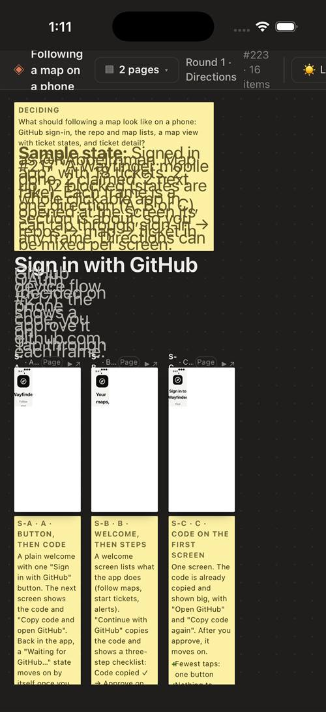
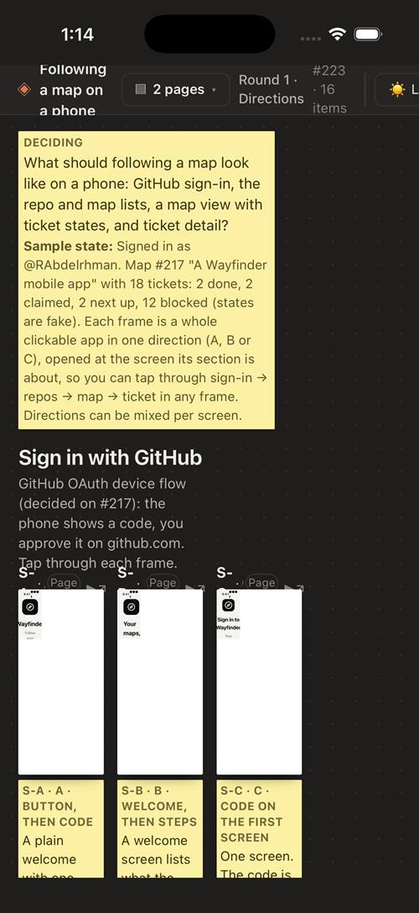
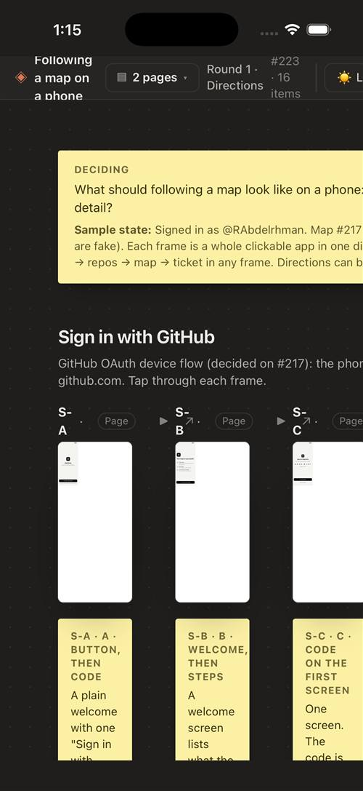
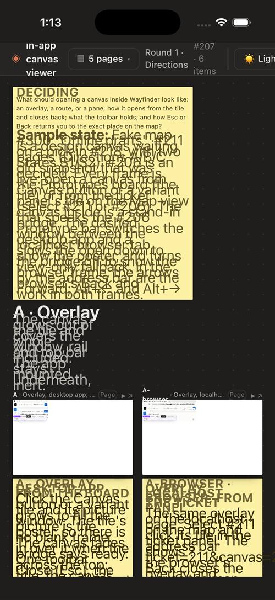
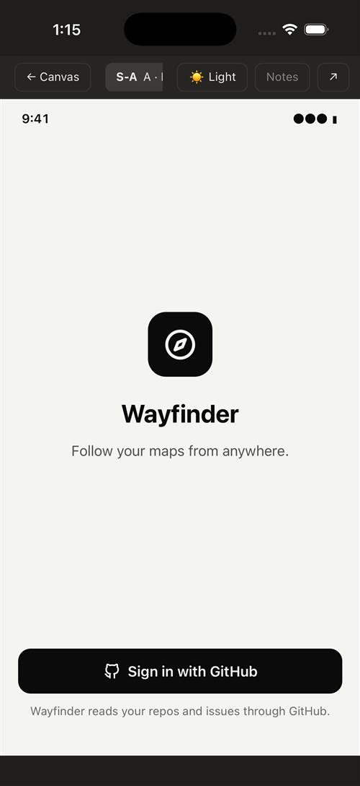
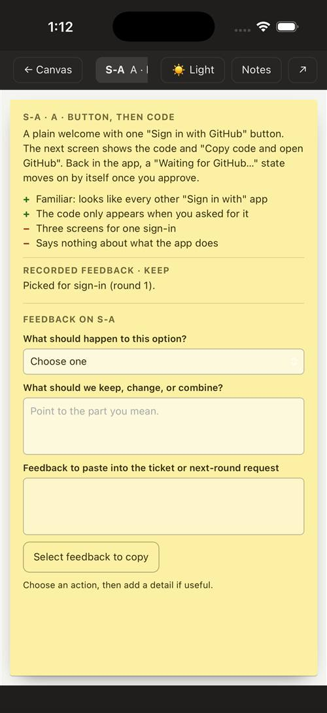
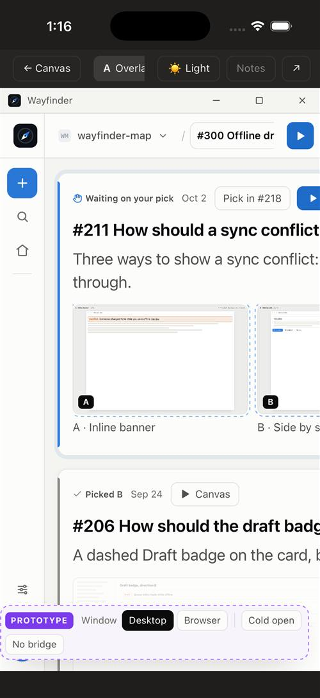
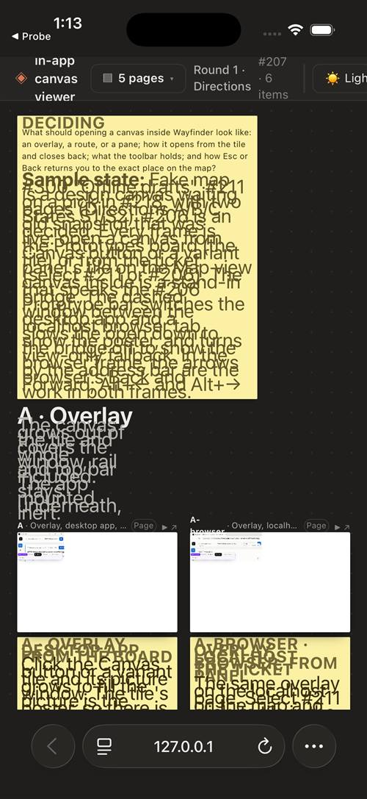

# Can prototype canvases render on a phone?

Research for [#221](https://github.com/RAbdelrhman/wayfinder-map/issues/221) on map #217 (A Wayfinder mobile app).

**Answer: partly.** Both canvases tested load and run on a real iOS `WKWebView` (iOS 26.4 Simulator), on a real Android System WebView 124, and on desktop WebKit and Chromium, with no script errors on the engines where errors were captured (desktop WebKit and Chromium, and the Android WebView; not the iOS Simulator runs, which only show that pages drew). That holds once the app downloads every file the canvas references, including two files outside `prototypes/`. Present (one option full screen) works, and a phone-sized canvas looks right there. The board doesn't:

- **Broken board thumbnails on every mobile WebView we ran.** On iOS `WKWebView` and Mobile Safari each thumbnail shows its page in a small patch in the frame's top-left corner and white everywhere else, or a cropped, enlarged corner. The real Android WebView 124 lays each frame out at a fraction of its width. Only desktop Chromium 153 draws them right. Moving the board from CSS `zoom` to `transform: scale()` was tried on iOS two ways, and **neither fixed it**. Don't count on live thumbnails on the phone.
- **Overlapping text on iOS.** iOS text autosizing inflates the canvas's text but not its line heights, so notes pile on top of each other. `-webkit-text-size-adjust: 100%` fixes it.
- **Chrome that doesn't fit.** The top bar runs off screen, the board fits at 26–30% so thumbnails can't be read, and desktop-width pages get cut off in Present.

## How it was tested

- **Canvases:** two real canvases. The desktop and Android runs used files downloaded through the GitHub REST API (`git/trees/{branch}?recursive=1`, then one `git/blobs/{sha}` request per file), as the phone app would. The iOS Simulator runs used full git checkouts of the two branches, not the API download.
  - `prototype/223-…` (#223, the mobile following screens, 16 phone-sized frames at 390 × 844).
  - `prototype/207-…` (#207, the in-app canvas viewer shell, 6 desktop-sized pages at 1440 × 900, 5 pages).
- **iOS, real:** an iPhone 17 Pro on the **iOS 26.4 Simulator**, run on a GitHub `macos-26` runner because Windows can't run the Simulator ([`probe/ios/`](mobile-canvas/probe/ios/), CI run 38739375640 on a throwaway branch). Two ways in:
  - a **bare `WKWebView` app** ([`Probe.swift`](mobile-canvas/probe/ios/Probe.swift)), loading the canvas from `file://` in the app's private `Documents` with `loadFileURL(_:allowingReadAccessTo:)` (as a cache written by `expo-file-system` would be) and over `http` with the desktop's `PROTOTYPE_CSP`;
  - **Mobile Safari**, over `http`.

  Screenshots come from `simctl io`. The probe app can also run a snippet of JavaScript after load, to try a fix without editing the canvas.
- **iOS, desktop WebKit:** Playwright WebKit 26.6 with the `iPhone 13` profile (390 × 844, touch, mobile). This ran first, before the Simulator was available.
- **Android:** Playwright Chromium 153 with the `Pixel 7` profile (412 × 915, touch, mobile), and **a real Android System WebView 124.0.6367.219** on an Android 15 emulator (1080 × 2400, 2.625 DPR, so 412 CSS px wide). The real WebView ran inside a minimal test app ([source](mobile-canvas/probe/android/)): `setJavaScriptEnabled`, `setAllowFileAccess`, `setUseWideViewPort`, built-in zoom, and a `WebViewClient`, as `react-native-webview` sets up. It was driven over adb and the WebView's DevTools socket (`device.mjs`, `measure.mjs`, `zoomtest.mjs`).
- **Two load modes, each tried on both engines:**
  - `http`: a local server that sends the desktop app's `PROTOTYPE_CSP` (`sandbox allow-scripts …`) and `nosniff` headers, as `src/server.ts` does.
  - `file`: files written to disk and opened as `file://` URLs, as an app would after caching them with `expo-file-system`.
- **Checks:** console and page errors, failed requests, horizontal overflow, which top-bar controls fall past the right edge, whether every board iframe rendered content, the Present view, and pinch zoom (Chromium only, through CDP `Input.synthesizePinchGesture`).

The scripts are in [`mobile-canvas/probe/`](mobile-canvas/probe/). Run them from a scratch folder with `playwright` installed.

## Results

| Canvas | Engine | Mode | Errors | Page width (viewport) | Board fit | Top-bar controls off screen | Frames with content |
|---|---|---|---|---|---|---|---|
| #223 | Desktop WebKit (Playwright, iOS profile) | http, file | none | 396 (390) | 26% | Present (6 px) | 16 / 16 loaded, but painted as cropped corners (see Zoom) |
| #223 | Desktop Chromium (Playwright, Android profile) | http, file | none | 412 (412) | 28% | none | 16 / 16 |
| #207 | Desktop WebKit (Playwright, iOS profile) | http, file | none | 540 (390) | 28% | zoom-fit, zoom-in, theme, help, Present | all loaded, painted as cropped corners |
| #207 | Desktop Chromium (Playwright, Android profile) | http, file | none | 533 (412), page shrunk to fit | 30% | none at 533, but text is shrunk | all |
| #223 | **Android System WebView 124** | file (app-private files dir) | none | 412 (412) | 28% | none | 16 / 16 loaded, but over-zoomed (see Zoom) |
| #207 | **Android System WebView 124** | file (app-private files dir) | none | 532 (412), page shrunk to fit | 30% | none at 532, but text is shrunk | all loaded, over-zoomed |
| #223 | **iOS 26.4 `WKWebView`** | file (app `Documents`), http | none seen¹ | 402 (402), page scroll width 575 | 27% | not measured (top bar clipped at the right edge) | screenshots show frames drawn (the probe read only 6 and could not see inside them), but each painted in a small top-left patch (see Zoom) |
| #207 | **iOS 26.4 `WKWebView`** | file (app `Documents`), http | none seen¹ | 402 (402), page scroll width 558 | 29% | not measured (top bar clipped at the right edge) | screenshots show frames drawn, same top-left patches |
| #223, #207 | **iOS 26.4 Mobile Safari** | http | not captured | same as `WKWebView` | same | same | same patches |

¹ The `WKWebView` probe doesn't capture console errors. It shows only that frames drew in the screenshots, not that nothing was logged or that every frame loaded. Frames sit at an opaque origin (the canvas's own `sandbox`), so the probe can't read inside them either.

"Errors: none" is after the fix in the next section. Before it, every variant page 404'd on one stylesheet. "Loaded" means each frame navigated to its page and has text in it. It doesn't mean the frame painted correctly: check the screenshots for that.

### Board

| #223 iOS | #223 Android | #207 iOS | #207 Android |
|---|---|---|---|
|  |  |  |  |

### Real iOS `WKWebView` (iOS 26.4 Simulator)

| #223 board | + `text-size-adjust: 100%` | + per-frame `transform` | #207 board |
|---|---|---|---|
|  |  |  |  |

| #223 Present, notes hidden | #223 Present, notes open (default) | #207 Present, notes hidden | #207 board in Mobile Safari |
|---|---|---|---|
|  |  |  |  |

The "per-frame `transform`" column is a post-load script: stage `zoom` back to 1, each frame's viewport resized by the zoom, each iframe's `transform: scale()` multiplied by it. The frame boxes now fit, but the page inside still fills only about a quarter of each box. The patch looks about the same size in the `zoom` and `transform` runs, which points at how iOS paints a heavily scaled-down iframe rather than at `zoom` itself. That's a guess; this research didn't isolate it.

### Real Android System WebView 124

| #223 board (thumbnails over-zoomed) | #223 board at 100% zoom (correct) | #207 Present, notes hidden |
|---|---|---|
|  |  |  |

The test app draws under the status bar (Android 15 is edge-to-edge for apps targeting SDK 35). A real app handles that with safe-area insets. It isn't a canvas problem.

### Present

| #223 Android, notes hidden | #223 iOS, notes open (default) | #207 iOS, notes hidden |
|---|---|---|
|  |  |  |

## What breaks

### Assets: files outside `prototypes/`

Variant pages link `../../../src/ui/styles.css` (the app's own stylesheet). Some also load `../../../assets/wayfinder-icon.svg`. A download of just `prototypes/` leaves those links dead, and the pages render unstyled ([screenshot](mobile-canvas/207-ios-board-missing-styles.jpg)). The desktop server never hits this, because it fetches any file on the branch when asked.

The app has to fetch the closure, not just the folder: scan the `.html`, `.css` and `.js` files for relative URLs, then fetch whatever resolves outside `prototypes/`. Cost per canvas: about 52–57 API requests and about 2 MB, which took 4–5 s over desktop Wi-Fi. That counts against the 5,000-requests-per-hour API limit, so cache by blob SHA. Blobs are content-addressed, so a re-open only fetches what changed.

### Layout widths

- **Top bar.** The board's top bar has no narrow layout. The title wraps to three lines. On #207 (5 pages, round label) on iOS, five controls fall off the right edge and the page scrolls sideways (540 px of content in 390 px). On Android, Chromium shrank the whole page to 533 px wide to fit, so all text got smaller.
- **Present bar.** The option chip is cut to a few characters ("A · Butto"). On the #207 Android run, the Notes button sat under another control, so a tap didn't reach it.
- **Notes open by default.** Present opens with the notes panel showing. On a phone it covers the whole frame (the `max-width: 640px` rule makes it `100vw - 24px` wide), so the first thing you see is notes, not the option.
- **Desktop-sized pages in Present.** The Present frame is the phone's width (390 or 412 px), not the page's `width` (1440). Pages built for desktop render squeezed and cut off on the right (#207). Phone-sized pages (#223, 390 px) look exactly right. The board already scales frames with `transform: scale()`. Present doesn't.

### Scripts

No script errors or failed requests on desktop WebKit and Chromium or the real Android WebView 124, in any load mode tried (once the missing stylesheet was fetched). The iOS Simulator probe does not capture errors, so for iOS this only means the pages drew. The engine's scripts ran: the board built every frame, page frames navigated and filled with content, option notes rendered, and Present and its theme and notes toggles responded. The help `<dialog>`, the feedback form and the ↗ links weren't exercised. The sandbox rules in the canvas README (relative paths, no modules or `fetch`, no storage) are what make the `file://` mode work as well.

Two things the real WebView showed about the app around the canvas:

- **Keep the cache in app-private storage.** Files pushed to the app's external folder (`/sdcard/Android/data/<pkg>/files`) failed with `ERR_FILE_NOT_FOUND` even with `allowFileAccess`. The same files in the private files dir (`/data/user/0/<pkg>/files`, which is where `expo-file-system`'s `documentDirectory` points) loaded.
- **Set a `WebViewClient`.** Without one, Android treats each iframe navigation as a request to launch another app and blocks it ("Denied starting an intent without a user gesture"), so every page frame stays at `about:blank`. `react-native-webview` always sets a client, so an Expo app is fine, but a hand-rolled WebView isn't.

Not tested here, and the app has to handle these:

- `react-native-webview` injects `window.ReactNativeWebView.postMessage` into the page. Canvas files are repo code, so the app should ignore messages from canvases, or only accept a fixed shape.
- "Open in a new tab" (↗) links use `target="_blank"`. The app has to handle `onOpenWindow`, or the link does nothing.
- Keyboard shortcuts (N, P, T, [ ], Esc) have no keys on a phone. Every action they cover needs a tappable control.

### Scroll and zoom

- **Scroll.** Not tested with a real swipe. From the code: the board is an `overflow: auto` element with default `touch-action`, so a one-finger swipe should scroll it natively. Drag-to-pan only starts on empty board space.
- **Zoom.** The canvas zooms only through its buttons and Ctrl + wheel. It has no pinch handler (`canvas.js`). A synthesized pinch (CDP `Input.synthesizePinchGesture`, on Chromium 153 and the real WebView 124, run while Present was open) zoomed the whole page instead: `visualViewport.scale` went 1 → 2 while the canvas zoom label stayed at 28–30%. So pinch zooms the page, toolbar included, not the canvas.
- **CSS `zoom` breaks board thumbnails.** The board scales with `zoom` on `#stage`, and frames inside it render wrong on two engines:
  - **Android System WebView 124:** an iframe inside a zoomed parent gets a viewport of its CSS width × zoom. At 28%, a 390 px phone frame was laid out 109 px wide (a 1440 px desktop frame: 431 px), so each thumbnail shows an enlarged corner. With `#stage` set back to `zoom: 1`, the same frames measured 390 px and rendered right ([screenshot](mobile-canvas/223-webview124-board-zoom100.jpg)).
  - **iOS 26.4 `WKWebView` and Mobile Safari (Simulator):** broken, and **not fixed by switching to `transform`**. Under `zoom`, each frame shows its page in a small top-left patch, with the rest of the box white ([#223](mobile-canvas/ios-223-wkwebview-board.jpg), [#207](mobile-canvas/ios-207-wkwebview-board.jpg)). Playwright's WebKit 26.6 on Windows paints it as a cropped corner at full size ([#223](mobile-canvas/223-ios-board.jpg), [#207](mobile-canvas/207-ios-board.jpg)). Two post-load fixes were tried in `WKWebView`. Stage `zoom` replaced by `transform: scale()` (the boxes then shrink correctly through the transform, and the frames still show a small patch). Then no ancestor zoom or transform at all, with each frame's own `transform: scale()` and its box resized instead (the boxes fit, the content is still a small patch). Neither renders a readable thumbnail. A proper engine change, run on a device, might behave differently from a script injected after load, but this research didn't find one that works.
  - **Chromium 153:** correct.

  System WebView updates through the Play Store, so most Android phones may not hit the 124 bug. The iOS result is the one that matters: it reproduces on the Simulator's `WKWebView`, which is what `react-native-webview` uses on iOS, and no `zoom`-to-`transform` swap fixed it.

- **Text size.** iOS text autosizing inflates the text in the canvas's notes and headings but leaves the line heights, so lines overlap ([screenshot](mobile-canvas/ios-223-wkwebview-board.jpg)). Android and desktop WebKit don't do this. Setting `-webkit-text-size-adjust: 100%` on `html` fixed it in the Simulator ([screenshot](mobile-canvas/ios-223-wkwebview-board-textadjust.jpg)). The canvas has a `width=device-width` viewport meta but no text-size rule.
- **Fit.** "Fit" lays the board out at 26–30% on a phone, so the frames can be seen but not read. That's fine for an overview. You then have to Present an option to read it.

## Recommended rendering approach

1. **Fetch through the GitHub API and cache to disk.** Read the branch tree once, then download the blobs under `prototypes/<canvas>/` plus the out-of-folder files they reference, into the app's cache directory keyed by blob SHA. Don't count on reaching the desktop server: it already serves canvases with the right sandbox, but a phone off the home network can't reach it.
2. **Load from `file://` in `react-native-webview`.** Use `allowFileAccess` on Android and `allowingReadAccessToURL` set to the cache folder on iOS. `file://` rendered the same as the sandboxed `http` mode on desktop WebKit, desktop Chromium and the iOS `WKWebView` (the Android WebView was tried with `file://` only), and it avoids adding a native module for a local HTTP server.

   **Rendering parity isn't security parity.** `file://` responses carry no CSP, so the desktop's `sandbox` header doesn't apply. Canvas files are repo code, and this research did not test how isolated they are from the app. Before shipping, do two things. First, load the canvas inside an `<iframe sandbox="allow-scripts">` from a small host page, so canvas code runs at an opaque origin. Second, leave `onMessage` unset, or accept only a fixed message shape, so canvas code can't reach the GitHub token or native APIs. Verify both on a device.
3. **Don't show the live board on the phone. Open one option at a time in Present.** The board's thumbnails are broken on iOS and on the Android WebView we ran, and a fix by swapping `zoom` for `transform` didn't work. Present is what works on both platforms (for #207's desktop-sized pages, only the left part shows):
   - The app opens a canvas straight into one option by URL hash (`index.html#<option id>`, e.g. `#S-A`). The iOS runs did exactly this.
   - The app needs its own list of options to switch between (id, name, kind). The board builds that list from `config.js` (`window.CANVAS`). Getting it into native UI means running `config.js` in a hidden WebView and reading `window.CANVAS` back over `postMessage`. **That wasn't tried here.** Without it, the phone can open Present at the first option and use the canvas's own ← → controls.
   - Thumbnails for a native option picker would have to come from somewhere other than live iframes, for example screenshots committed next to the canvas. **Not tried here either.**
4. **Make the canvas engine fit a phone.** Engine work in `prototypes/canvas`, shipped to every canvas through the scaffold. A phone app that loads a canvas through Present needs these:
   - add `html { -webkit-text-size-adjust: 100% }`, so iOS doesn't inflate text and overlap lines (verified in the Simulator);
   - a narrow top bar, with the title on one line and the secondary controls in a menu;
   - Present scales a page to its declared `width`, as the board already does;
   - notes start hidden below about 640 px;
   - pinch on the board drives the canvas zoom (`touch-action` plus pointer events), not the page.

   Present, notes, the top bar and pinch are visible UI changes, so per the map's rules they need a prototype the user picks before anyone builds them. The text-size rule changes nothing the user sees on desktop and can ship on its own.

Until step 4 lands, phone-sized canvases like #223 work well today in Present, on both platforms, with the notes closed. Desktop-sized canvases like #207 are cut off at the phone's width, so only part of the page can be seen.

## Still to verify

- **Older iOS and the Android WebView most phones run.** The iOS result is one runtime (26.4, `WKWebView` UA reports iOS 18.7). Check at least one older iOS in the Simulator, and a current Android System WebView (the emulator image ships 124 and has no Play Store to update it).
- **A device build.** The Simulator runs desktop-class graphics. A real iPhone could paint the scaled-down iframes differently.
- **The hidden-WebView step in recommendation 3.** Reading `window.CANVAS` out of `config.js`, and any thumbnail source.
- **Isolation from the app** (see the warning in step 2), and the `postMessage`, `onOpenWindow` and shortcut items under Scripts.
