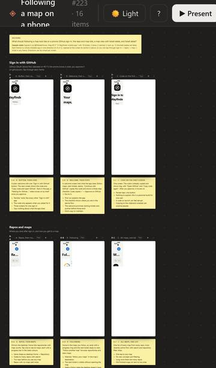
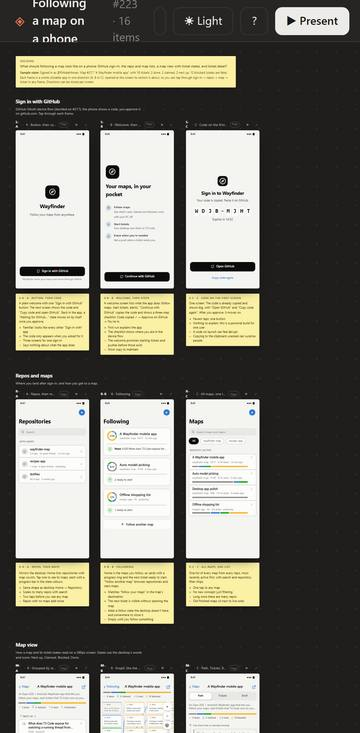
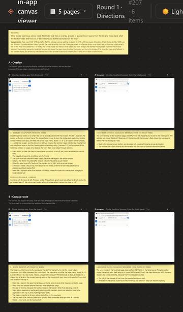
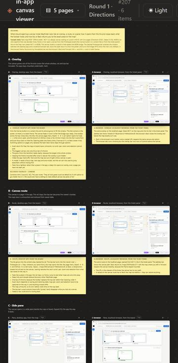
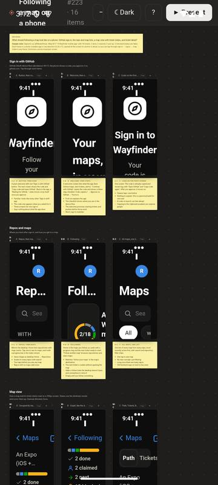
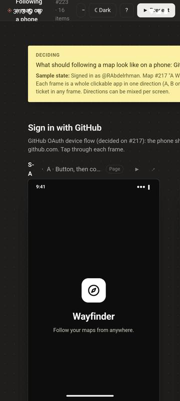
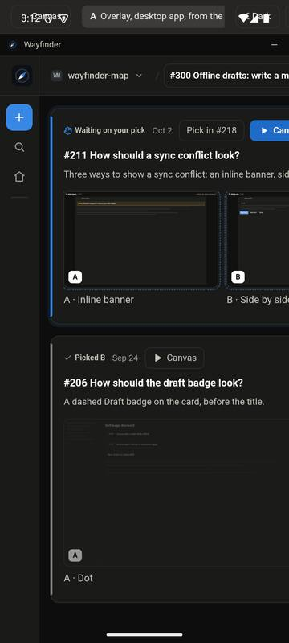
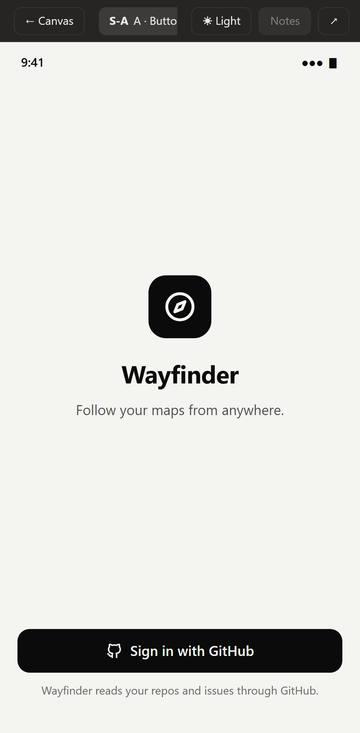
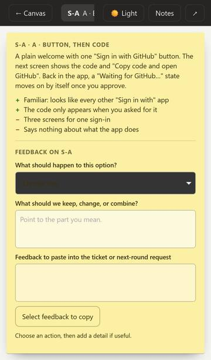
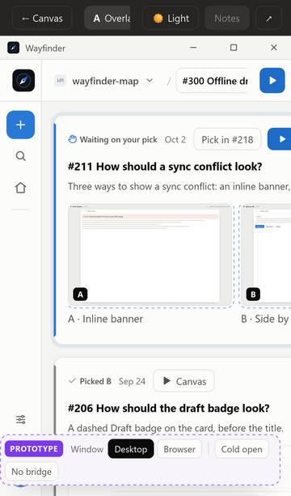

# Can prototype canvases render on a phone?

Research for [#221](https://github.com/RAbdelrhman/wayfinder-map/issues/221) on map #217 (A Wayfinder mobile app).

**Answer: yes.** Both canvases tested load and run on the iOS engine (WebKit) and the Android engine (Chromium) at phone size, with no script errors. That holds once the app downloads every file the canvas references, including two files outside `prototypes/`. The canvas engine runs fine on a phone. Its chrome doesn't fit one: the top bar runs off screen, the board fits at 26–30% so thumbnails can't be read, and desktop-width pages get cut off in Present. One engine bug matters too: on an older Android System WebView (124), the board's CSS `zoom` shrinks each frame's viewport, so board thumbnails render over-zoomed. Present is unaffected.

## How it was tested

- **Canvases:** two real canvases, downloaded through the GitHub REST API (`git/trees/{branch}?recursive=1`, then one `git/blobs/{sha}` request per file), as the phone app would.
  - `prototype/223-…` (#223, the mobile following screens, 16 phone-sized frames at 390 × 844).
  - `prototype/207-…` (#207, the in-app canvas viewer shell, 6 desktop-sized pages at 1440 × 900, 5 pages).
- **iOS:** Playwright WebKit 26.6 with the `iPhone 13` profile (390 × 844, touch, mobile). WebKit is the engine inside `WKWebView`. Windows can't run the iOS Simulator, so a real `WKWebView` wasn't tested.
- **Android:** Playwright Chromium 153 with the `Pixel 7` profile (412 × 915, touch, mobile), and **a real Android System WebView 124.0.6367.219** on an Android 15 emulator (1080 × 2400, 2.625 DPR, so 412 CSS px wide). The real WebView ran inside a minimal test app ([source](mobile-canvas/probe/android/)): `setJavaScriptEnabled`, `setAllowFileAccess`, `setUseWideViewPort`, built-in zoom, and a `WebViewClient`, as `react-native-webview` sets up. It was driven over adb and the WebView's DevTools socket (`device.mjs`, `measure.mjs`, `zoomtest.mjs`).
- **Two load modes, each tried on both engines:**
  - `http`: a local server that sends the desktop app's `PROTOTYPE_CSP` (`sandbox allow-scripts …`) and `nosniff` headers, as `src/server.ts` does.
  - `file`: files written to disk and opened as `file://` URLs, as an app would after caching them with `expo-file-system`.
- **Checks:** console and page errors, failed requests, horizontal overflow, which top-bar controls fall past the right edge, whether every board iframe rendered content, the Present view, and pinch zoom (Chromium only, through CDP `Input.synthesizePinchGesture`).

The scripts are in [`mobile-canvas/probe/`](mobile-canvas/probe/). Run them from a scratch folder with `playwright` installed.

## Results

| Canvas | Engine | Mode | Errors | Page width (viewport) | Board fit | Top-bar controls off screen | Frames with content |
|---|---|---|---|---|---|---|---|
| #223 | WebKit (iOS) | http, file | none | 396 (390) | 26% | Present (6 px) | 16 / 16 |
| #223 | Chromium (Android) | http, file | none | 412 (412) | 28% | none | 16 / 16 |
| #207 | WebKit (iOS) | http, file | none | 540 (390) | 28% | zoom-fit, zoom-in, theme, help, Present | all |
| #207 | Chromium (Android) | http, file | none | 533 (412), page shrunk to fit | 30% | none at 533, but text is shrunk | all |
| #223 | **Android System WebView 124** | file (app-private files dir) | none | 412 (412) | 28% | none | 16 / 16 loaded, but over-zoomed (see Zoom) |
| #207 | **Android System WebView 124** | file (app-private files dir) | none | 532 (412), page shrunk to fit | 30% | none at 532, but text is shrunk | all loaded, over-zoomed |

"Errors: none" is after the fix in the next section. Before it, every variant page 404'd on one stylesheet.

### Board

| #223 iOS | #223 Android | #207 iOS | #207 Android |
|---|---|---|---|
|  |  |  |  |

### Real Android System WebView 124

| #223 board (thumbnails over-zoomed) | #223 board at 100% zoom (correct) | #207 Present, notes hidden |
|---|---|---|
|  |  |  |

The test app draws under the status bar (Android 15 is edge-to-edge for apps targeting SDK 35). A real app handles that with safe-area insets. It isn't a canvas problem.

### Present

| #223 Android, notes hidden | #223 iOS, notes open (default) | #207 iOS, notes hidden |
|---|---|---|
|  |  |  |

## What breaks

### Assets: files outside `prototypes/`

Variant pages link `../../../src/ui/styles.css` (the app's own stylesheet). Some also load `../../../assets/wayfinder-icon.svg`. A download of just `prototypes/` leaves those links dead, and the pages render unstyled ([screenshot](mobile-canvas/207-ios-board-missing-styles.jpg)). The desktop server never hits this, because it fetches any file on the branch when asked.

The app has to fetch the closure, not just the folder: scan the `.html`, `.css` and `.js` files for relative URLs, then fetch whatever resolves outside `prototypes/`. Cost per canvas: about 52–57 API requests and about 2 MB, which took 4–5 s over desktop Wi-Fi. That counts against the 5,000-requests-per-hour API limit, so cache by blob SHA. Blobs are content-addressed, so a re-open only fetches what changed.

### Layout widths

- **Top bar.** The board's top bar has no narrow layout. The title wraps to three lines. On #207 (5 pages, round label) on iOS, five controls fall off the right edge and the page scrolls sideways (540 px of content in 390 px). On Android, Chromium shrank the whole page to 533 px wide to fit, so all text got smaller.
- **Present bar.** The option chip is cut to a few characters ("A · Butto"). On the #207 Android run, the Notes button sat under another control, so a tap didn't reach it.
- **Notes open by default.** Present opens with the notes panel showing. On a phone it covers the whole frame (the `max-width: 640px` rule makes it `100vw - 24px` wide), so the first thing you see is notes, not the option.
- **Desktop-sized pages in Present.** The Present frame is the phone's width (390 or 412 px), not the page's `width` (1440). Pages built for desktop render squeezed and cut off on the right (#207). Phone-sized pages (#223, 390 px) look exactly right. The board already scales frames with `transform: scale()`. Present doesn't.

### Scripts

Nothing broke. Classic `<script src>`, `srcdoc` frames, `ResizeObserver` and `postMessage` height reports, `<dialog>` and hash routing all worked on every engine, in every load mode, including the real WebView 124. CSS `zoom` worked on WebKit 26.6 and Chromium 153. On WebView 124 it hits the iframe bug described under Zoom. The sandbox rules in the canvas README (relative paths, no modules or `fetch`, no storage) are what make the `file://` mode work as well.

Two things the real WebView showed about the app around the canvas:

- **Keep the cache in app-private storage.** Files pushed to the app's external folder (`/sdcard/Android/data/<pkg>/files`) failed with `ERR_FILE_NOT_FOUND` even with `allowFileAccess`. The same files in the private files dir (`/data/user/0/<pkg>/files`, which is where `expo-file-system`'s `documentDirectory` points) loaded.
- **Set a `WebViewClient`.** Without one, Android treats each iframe navigation as a request to launch another app and blocks it ("Denied starting an intent without a user gesture"), so every page frame stays at `about:blank`. `react-native-webview` always sets a client, so an Expo app is fine, but a hand-rolled WebView isn't.

Not tested here, and the app has to handle these:

- `react-native-webview` injects `window.ReactNativeWebView.postMessage` into the page. Canvas files are repo code, so the app should ignore messages from canvases, or only accept a fixed shape.
- "Open in a new tab" (↗) links use `target="_blank"`. The app has to handle `onOpenWindow`, or the link does nothing.
- Keyboard shortcuts (N, P, T, [ ], Esc) have no keys on a phone. Every action they cover needs a tappable control.

### Scroll and zoom

- **Scroll.** The board is an `overflow: auto` element with default `touch-action`, so a one-finger swipe scrolls it natively. Drag-to-pan uses pointer events and doesn't get in the way.
- **Zoom.** The canvas zooms only through its buttons and Ctrl + wheel. It has no pinch handler. Pinching zooms the whole page instead (Chromium 153 and the real WebView 124: `visualViewport.scale` went 1 → 2 while the canvas zoom stayed at 28%), toolbar included. Pinch works, but it zooms the wrong thing.
- **CSS `zoom` and iframes on older WebViews.** The board scales with `zoom` on `#stage`. On WebView 124, an iframe inside a zoomed ancestor gets a viewport of its CSS width × zoom. At 28%, a 390 px phone frame was laid out 109 px wide (a 1440 px desktop frame: 431 px), so every thumbnail shows an enlarged, cropped corner. With `#stage` set back to `zoom: 1`, the same frames measured 390 px and rendered right. Chromium 153 lays them out at full width under zoom, so newer Chromium has fixed this (CSS `zoom` was standardized around Chrome 128). System WebView updates through the Play Store, so most phones run a current version. Even so, the board should scale with `transform: scale()` alone (as each frame already does) rather than `zoom`, and not depend on the WebView version.
- **Fit.** "Fit" lays the board out at 26–30% on a phone, so the frames can be seen but not read. That's fine for an overview. You then have to Present an option to read it.

## Recommended rendering approach

1. **Fetch through the GitHub API and cache to disk.** Read the branch tree once, then download the blobs under `prototypes/<canvas>/` plus the out-of-folder files they reference, into the app's cache directory keyed by blob SHA. Don't count on reaching the desktop server: it already serves canvases with the right sandbox, but a phone off the home network can't reach it.
2. **Load from `file://` in `react-native-webview`.** Use `allowFileAccess` on Android and `allowingReadAccessToURL` set to the cache folder on iOS. Leave `onMessage` unset, or ignore canvas messages. `file://` worked identically to the sandboxed `http` mode in both engines. It skips a local HTTP server, which would add a native module just to send a CSP header. The WebView keeps canvas code away from the app's token and native API.
3. **Make the canvas engine fit a phone.** This is engine work in `prototypes/canvas`, shipped to every canvas through the scaffold:
   - a narrow top bar, with the title on one line and the secondary controls in a menu;
   - Present scales a page to its declared `width`, as the board already does;
   - notes start hidden below about 640 px;
   - pinch on the board drives the canvas zoom (`touch-action` plus pointer events), not the page;
   - the board zooms with `transform` instead of CSS `zoom`, so thumbnails render right on older Android WebViews.

   These are visible UI changes, so per the map's rules they need a prototype the user picks before anyone builds them.

Until step 3 lands, phone-sized canvases like #223 work well today in Present. Desktop-sized canvases can be looked at, but pinch is the only way to read them.

## Still to verify

- **A real iOS `WKWebView`.** It needs a Mac or a device build. WebKit 26.6 is the same engine, but `WKWebView` file-access rules (`allowingReadAccessToURL`) differ from desktop WebKit's, and older iOS versions may handle CSS `zoom` around iframes the way WebView 124 does.
- **A current Android System WebView** (what most phones run), to confirm the zoom bug is gone there. The emulator image ships 124 and has no Play Store to update it.
