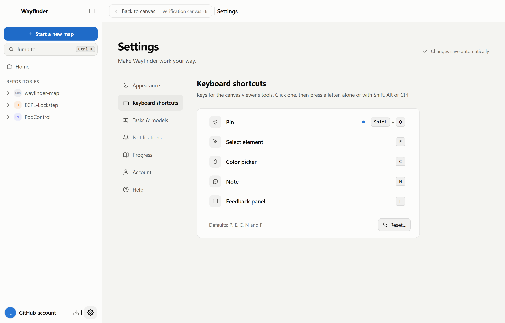
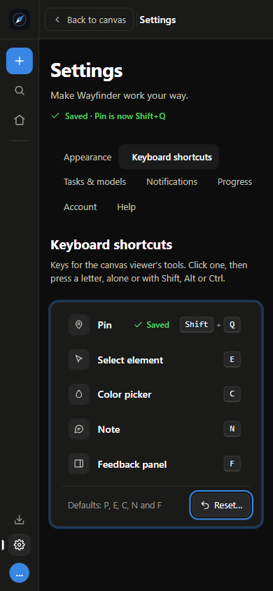

# Canvas keyboard shortcuts, #318

Implements #292 Round 3, changed-reset/D, from retained branch `prototype/292-prototype-settings-keyboard-shortcuts-for-the-canvas-viewer-s-to` at `40b30553c3b2fdb895afbf2da71506ae63e496d0`. The submitted choice was "Keep D (Recommended)". Production keeps D's compact inline capture and selective reset. There is no per-key default button.

## Owner decisions

The #318 T3 thread settled the remaining policies before implementation:

- Block combinations with an existing app/browser action and name that action in D's error line.
- Capture typed A–Z with Shift/Alt/Ctrl. Ignore composition, dead keys and AltGr text entry. Meta combinations are unavailable.
- Saved viewer tool shortcuts take priority over canvas-engine commands. Existing engine screen controls remain available. This was explicitly submitted on 2026-10-23 after independent review found the T/P/N collision.
- Keep existing pane/float routing: map keys belong to the map outside the viewer. Shortcuts opens full Settings in every mode, retaining the live canvas until Back to canvas.

The reserved-action list uses Wayfinder's Jump to handler and [Chromium's documented shortcuts](https://support.google.com/chrome/answer/157179?hl=en). Storage, displayed keys, ARIA hints and the bridge use one canonical format.

## Automated evidence

```powershell
npm run typecheck
npm run lint
npm test -- --maxWorkers=2
npm run build
```

Typecheck, lint and build exit 0. The final full suite passes **132 files, 1765 tests** on the latest main baseline `838ef87` plus this change.

Tests cover normalization, named tool/reserved conflicts, durable saves, failed storage, concurrent edits, selective reset snapshots, Escape/cancel, focus and live regions, storage events, hints/handlers, and text-input exclusion. The bridge regression registers the actual `prototypes/canvas/canvas.js` listener before the bridge, then dispatches DOM keyboard events through capture/bubble. It covers initial and repeated T, Shift+P and N presses, unassigned engine keys and text fields. Matching repeats are consumed without activating the tool again. A standalone canvas without viewer configuration retains its engine keys.

## Runtime evidence

The [runtime script](318/runtime-matrix.mjs) opens the built UI in Chromium or a separate source-built Electron app. It supplies controlled prototype files at the network boundary, using the real canvas HTML/CSS/engine, `viewerPrototypeBytes`, the real bridge and nested option frames. It does not simulate capture, saving, Settings, history or viewer handlers. A verification entry avoids depending on GitHub branch discovery. No GitHub comments or T3 messages are posted.

- [Electron results](318/electron-results.json): 12 cases, light/dark, 1280px/900px, full/pane/float. The desktop app's configured minimum width is 900px.
- [Localhost results](318/localhost-results.json): 12 cases, light/dark, 1280px/390px, full/pane/float.
- Every case exercises heading focus, named tool and reserved clashes, Escape, saving, live-region text, one-change reset/cancel, two-change reset with Cancel focused, exactly two Saved rows, Back context, the same mounted canvas and option, updated hints, host and nested-frame key handling, and text-field exclusion.
- Additional real-engine checks assign T and Shift+P to Pin and focus the engine toolbar. The tool fires without changing theme or opening the page menu. Clicking the engine theme button still changes its theme.
- Before the controlled fixture, the live #292 localhost canvas also passed the round trip with the same iframe/source, option B, selected tool, updated hint and returned focus. Settings categories and browser Back/Forward were exercised.

At 390px, the existing pane/float toolbar extends beyond its narrow pane. Those cases use keyboard activation of Shortcuts; the narrow full-window case uses the pointer. No new responsive viewer layout was added. Settings itself has no horizontal overflow at the tested widths.

Announcements were checked through live-region text, ARIA semantics and focus changes. Actual screen-reader speech, physical IME hardware and arbitrary OS/user-installed hotkeys were not tested. Desktop results cover built Electron source, not an installed release or updater deployment.

Reproduce from the repository root after `bun install --frozen-lockfile` and `npm run build`. Start localhost separately, then run the two surfaces:

```powershell
node dist/cli.js --repo RAbdelrhman/wayfinder-map --port 4488 --no-open
node docs/verification/318/runtime-matrix.mjs
node docs/verification/318/runtime-matrix.mjs --desktop
```

Current results and screenshots go under `output/playwright/`. Electron uses `.generated/318-matrix-profile`; the installed app remains unchanged.

## Screenshots

Source-built Electron, light:



Localhost at 390px, dark:


